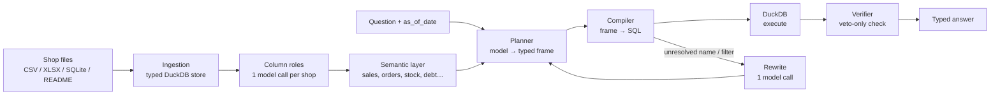

# DataMate — Zalo AI Challenge 2026

An offline question-answering system for Vietnamese small-business data. Given a shop's raw files (CSV, XLSX,
SQLite and a README), the shared rulebook and calendar, it answers natural-language questions such as
*"Tháng 3/2026 bán ra bao nhiêu cây Ống PVC Bình Minh D32?"* with a typed answer.

The core design choice: **the language model never computes numbers.** It reads the question and produces a
small, typed *frame* (intent, entities, period, filters). A deterministic compiler turns that frame into SQL,
DuckDB executes it over normalized data, and the result is formatted into the answer. Every answer is
therefore traceable to an executed query.

- Entry point: `bash /code/predict.sh` (no arguments) — reads `/data`, writes `/result/submission.jsonl` and
  `/result/logs/`, fully offline.
- One model: **Qwen3.5-9B**, unmodified, served locally by vLLM.
- No training or fine-tuning.

---

## 1. Running the image

```bash
docker run --rm --gpus '"device=0,1"' --network none --shm-size=16g \
  --entrypoint bash \
  -v /path/to/test_split:/data:ro \
  -v /path/to/output:/result \
  zaic2026_datamate_hvt-m:final /code/predict.sh
```

`predict.sh` starts a local vLLM server, waits until it is healthy, runs the solver over every question and
validates the submission. It detects the visible GPUs and uses tensor parallelism over up to two of them.
All settings are fixed inside the script; nothing needs to be passed in.

| Input (read-only) | Output |
|---|---|
| `/data/data/<business_id>/` — shop files + `README.md` | `/result/submission.jsonl` — one answer per line, appended as soon as each question finishes |
| `/data/rulebook.md`, `/data/calendar.csv` | `/result/logs/<question_id>.json` — one log record per question |
| `/data/questions.jsonl` | `/result/vllm_server.log` — model server log |

Temporary files (the per-shop DuckDB stores) go to `/tmp/datamate_cache`; `/data` is never written.

## 2. Approach



### 2.1 Reading the data (once per shop)
- **Ingestion** (`ingestion.py`, `parsing.py`, `quality.py`) reads every CSV, XLSX sheet and SQLite table,
  finds the header row, merges monthly sheets and split files that share a schema, and normalizes Vietnamese
  dates, money and numbers. Each typed column keeps its original text in a `__raw` column, and every row keeps
  its source file, sheet and row number. Results are cached in a DuckDB file keyed by a content hash.
- **Column roles** (`roles.py`): column meaning is resolved from aliases and the shop README first; one model
  call per shop maps the remaining unfamiliar headers to roles, and its output is checked against the values.
- **Semantic layer** (`semantics.py`, `domains.py`, `specialty.py`): schema-driven views — sales lines, orders,
  customers, products, stock, purchases, debt, and domain tables for cafés, pharmacies, mother-and-baby stores,
  phone shops and repair shops — implementing the rulebook (order status, returns and cancellations, unit
  conversion, toppings, duplicates, guest customers…). There are no branches on business or question IDs.
- **Calendar** (`temporal.py`): solar and lunar dates, relative periods ("tháng này", "quý trước", "N ngày gần
  nhất") resolved against each question's `as_of_date`.

### 2.2 Answering a question
1. **Plan.** The model receives the question, the shop catalog and the rulebook context and returns a typed
   frame as strict JSON (`core.py`, `prompts.py`, `contracts.py`). `intent.py` grounds the frame in explicit
   constraints of the question.
2. **Compile and execute.** `core.py`/`engine.py` compile the frame into a read-only SQL query (SELECT/CTE
   only, shop tables only, 15 s timeout, bounded result size) and run it on DuckDB.
3. **Repair.** If a name, filter or period cannot be resolved, the question is rewritten once using names that
   exist in the shop's data, then planned again (`repair.py`).
4. **Verify.** A second model call with reasoning enabled checks that the SQL answers the question that was
   asked (`verify.py`). It can only veto, never change a value; a veto requires a second independent call that
   also vetoes, and a vetoed answer becomes `abstain`.
5. **Format.** `output.py` produces the typed answer and its rounding.

### 2.3 Choosing between an answer, `unanswerable` and `abstain`
Scoring penalizes wrong answers, so the system prefers not to answer over guessing:
- a value (`number`, `percent`, `string`, `date`, `boolean`, `list`, `table`) only when the compiled query ran
  and passed type and verification checks;
- `unanswerable` (with a reason) when the shop's data does not record what is asked, as defined by the rulebook;
- `abstain` when the question could not be resolved within budget (≤ 4 model calls, 300 s per question) or was
  vetoed.

### 2.4 Logs
One JSON file per question in `/result/logs/` with the fields required by the submission guide:

| Field | Content |
|---|---|
| `id` | question ID |
| `answer` | final answer object |
| `elapsed_ms` | wall-clock milliseconds from the moment the question gets a worker slot (enters the batch) to its final answer, including data reads, model calls and SQL execution |
| `thinking` | list of the model's reasoning texts, in call order, exactly as generated; `null` if none |
| `code` | list of SQL statements actually executed |
| `output` | result of the last execution (columns and rows) |

The same record also keeps the full trace: prompt messages, every model call (raw content, reasoning, finish
reason, token usage, latency), the frame, the plan, every SQL execution and the verification result.

## 3. Models

| Name | Public source | Fixed revision | Original release | License | Parameters |
|---|---|---|---|---|---|
| Qwen3.5-9B | https://huggingface.co/Qwen/Qwen3.5-9B | `c202236235762e1c871ad0ccb60c8ee5ba337b9a` | 2026-02-27 | Apache-2.0 | 9,653,104,368 (≈ 9.65 B) |

- Used unmodified in bfloat16; no adapter, no quantization, no embedding/reranker/classifier models.
  Total inference parameters: ≈ 9.65 B (≤ 15 B).
- Weights, tokenizer and config are stored in the image at `/code/models/Qwen3.5-9B`.
- Served by vLLM 0.27.1 (`vllm/vllm-openai:v0.27.1-cu129`, PyTorch 2.13 + CUDA 12.9, Blackwell support).
  The recommended `v0.10.1.1` image predates the Qwen3.5 architecture.

## 4. Data

### 4.1 Sources
| Data | Source | Use |
|---|---|---|
| Train split (30 shops, 3,000 questions with answers, rulebook, calendar) | Official challenge data | Rule design, error analysis and local evaluation |
| Paraphrase set 1 (`paraphrases_v1`): 750 generated, 663 kept | Self-generated from train questions with Qwen3.5-9B (temperature 0.7, seed 42, 25 per shop) | Robustness to wording; answers inherited from train |
| Paraphrase set 2 (`paraphrases_v2`): 450 generated, 404 kept | Self-generated from train questions with Qwen3.5-9B (temperature 0.7, seed 7, 15 per shop) | Held-out robustness check |
| Generated shops (phone, mother-and-baby, repair) | Built programmatically following the public-test rulebook (generator scripts are not included in the image) | Unit tests of domain rules |

Prompts and raw responses for both paraphrase sets are stored in `generation.jsonl`, since sampled generation
is not bit-reproducible.

### 4.2 Train / validation split
Shops are split by business, with seed 42 (`training_code/data/manifests/groups.json`):

| Split | Shops | Questions |
|---|---:|---:|
| build | 18 | 1,736 |
| dev | 6 | 632 |
| lockbox | 6 | 632 |

## 5. Training

**No training, fine-tuning or adapter was used.** The inference weights are the original Qwen3.5-9B
checkpoint. `/code/training_code/` contains everything needed to verify the development data:

```
training_code/
├── README.md            details of each folder and how to regenerate artefacts
├── train.sh             regenerates data_manifest.json (no training step exists)
├── requirements.txt     pinned dependencies
├── configs/pipeline.json  fixed inference settings
├── src/make_manifest.py
├── data/                train split, splits/manifests, paraphrase sets
├── logs/, checkpoints/  empty: nothing was trained
└── data_manifest.json   local paths, sizes, SHA-256 of every data/config file
```

## 6. Reproducibility and runtime

**Fixed settings** (`predict.sh`, `training_code/configs/pipeline.json`): planner temperature 0 with request
seed 42, server seed 42, `max-model-len` 32,768, ≤ 3,000 output tokens per call, concurrency 16, ≤ 4 model calls
and 300 s per question.

**Determinism.** SQL compilation and execution are deterministic. Variation can only come from GPU batching
of model calls. On the same 100 public questions, three runs of the image produced identical submissions.

**Runtime** (measured on 1 × RTX 5090, 100 questions):

| Stage | Time |
|---|---:|
| vLLM start-up (load, compile, CUDA graphs) | ≈ 5 min |
| Solving 100 questions | 519 s |
| Estimated 500 questions, including start-up | ≈ 50 min |

Shops are prepared in a process pool and answered concurrently (up to 4 shops, 16 questions in flight), so
data ingestion overlaps model inference. The scoring machine's two GPUs give a larger KV cache and faster
generation than these measurements.

**Known limitation.** For orders whose lines record different customer names, payment methods or channels,
the order-level value is taken from one of its lines without a fixed tie-break, so it can differ between runs.

## 7. Building and exporting

The weights are downloaded once, at build time, at the pinned revision.

```bash
docker build --platform linux/amd64 -t zaic2026_datamate_hvt-m:final .

set -o pipefail
docker save zaic2026_datamate_hvt-m:final | pigz -p 8 > zaic2026_datamate_hvt-m.tar.gz
pigz -dc zaic2026_datamate_hvt-m.tar.gz | wc -c          # uncompressed .tar size in bytes
md5sum zaic2026_datamate_hvt-m.tar.gz > zaic2026_datamate_hvt-m.tar.gz.md5
```

Image layout:

| Path | Content |
|---|---|
| `/code/predict.sh` | entry point |
| `/code/README.md` | this document |
| `/code/src/datamate/` | solver |
| `/code/requirements.txt` | solver dependencies, installed in `/opt/dm` |
| `/code/models/Qwen3.5-9B/` | model weights, tokenizer, config |
| `/code/training_code/` | development data, generation code, manifest |

## 8. Local development

```bash
uv venv .venv --python 3.12
uv pip install --python .venv/bin/python -r requirements.lock
uv pip install --python .venv/bin/python --no-deps -e .
cp .env.example .env          # OpenAI-compatible endpoint serving Qwen3.5-9B

.venv/bin/python -m pytest -q                                   # unit tests
.venv/bin/python -m datamate prepare --split train              # ingest only, no model calls
.venv/bin/python -m datamate run --split train --questions training_code/data/manifests/dev.jsonl \
  --out runs/dev --concurrency 16 --temperature 0 --specialist off --role-inference fallback \
  --repair rewrite --verify check --deadline 300
.venv/bin/python -m datamate evaluate --run runs/dev --answers train/answers.jsonl
.venv/bin/python scripts/time_stress.py                         # stress test of the date parser
```

`run` never reads answers; only `evaluate` opens `answers.jsonl`, after inference has finished.

| Module | Role |
|---|---|
| `ingestion.py`, `parsing.py`, `quality.py` | file reading, normalization, cache |
| `roles.py`, `semantics.py`, `domains.py`, `specialty.py` | column roles and semantic tables |
| `core.py`, `intent.py`, `contracts.py`, `temporal.py`, `lexicon.py` | frames, compilation, periods, typo-tolerant vocabulary |
| `engine.py`, `output.py` | guarded SQL execution, answer formatting |
| `provider.py`, `prompts.py`, `repair.py`, `verify.py` | model calls, prompts, rewrite, verification |
| `runtime.py`, `cli.py` | orchestration, CLI |
| `evaluation.py` | local scorer, kept separate from inference |
